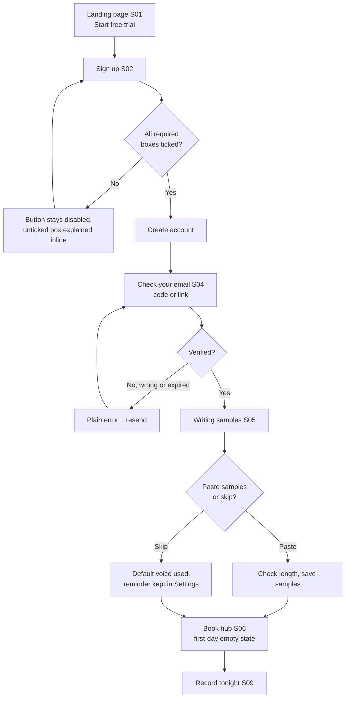
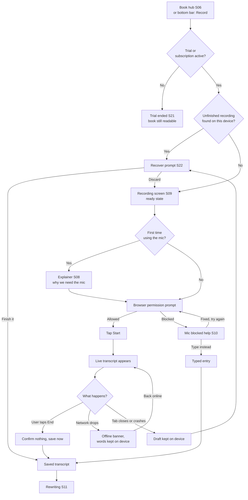
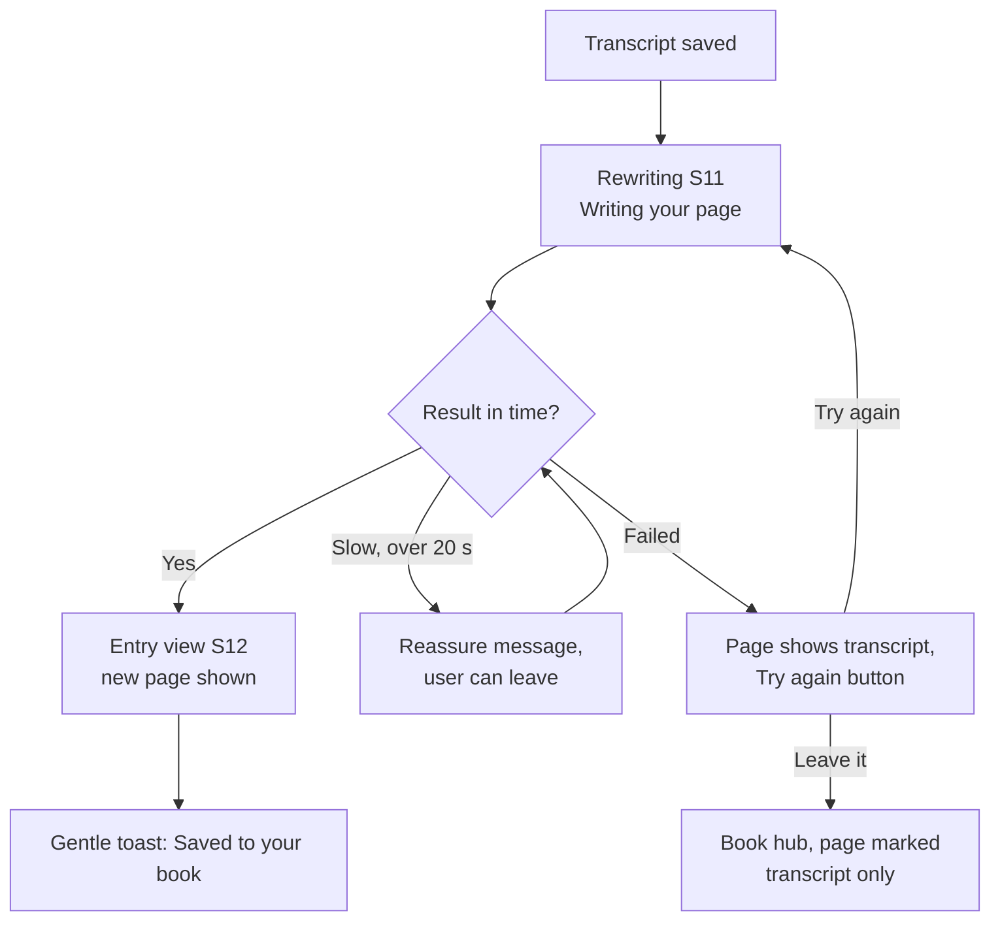
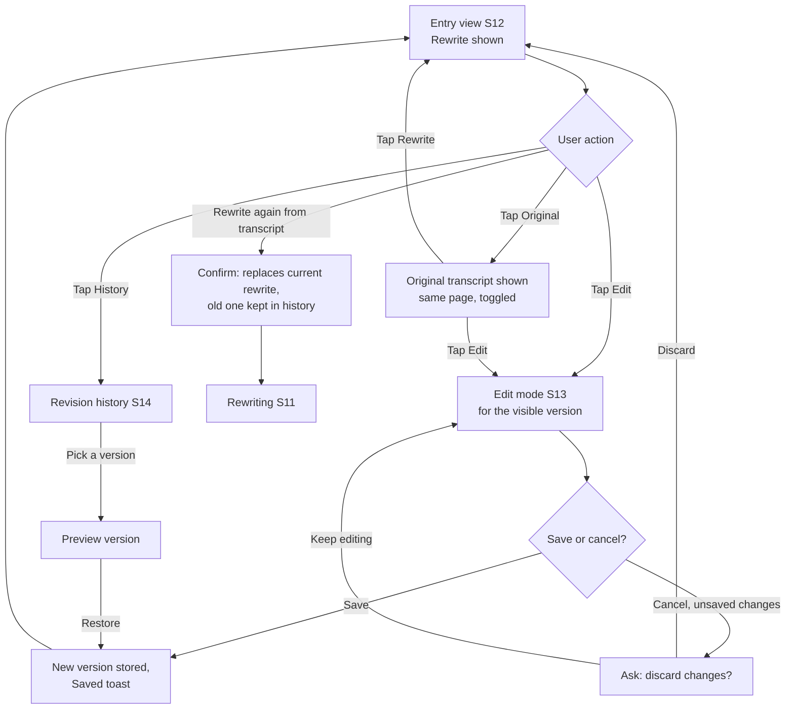
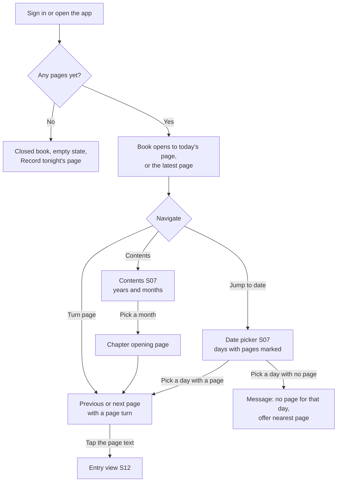
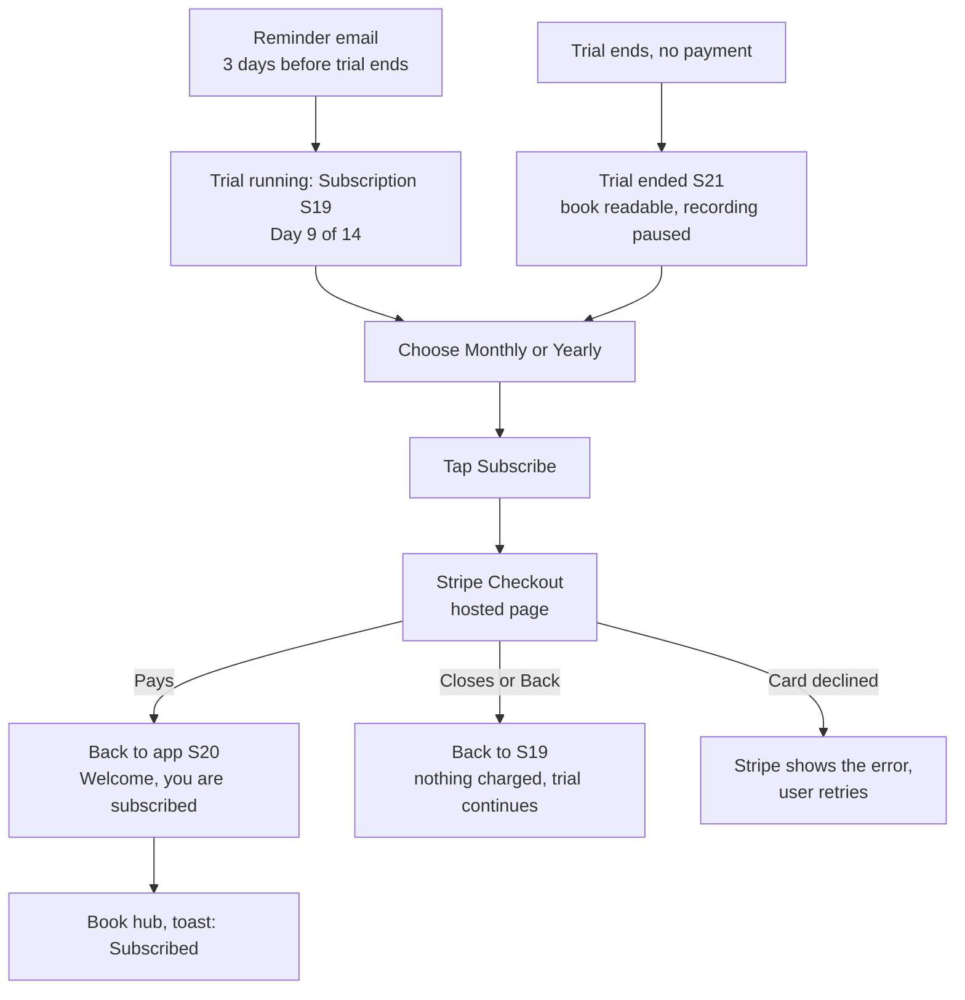
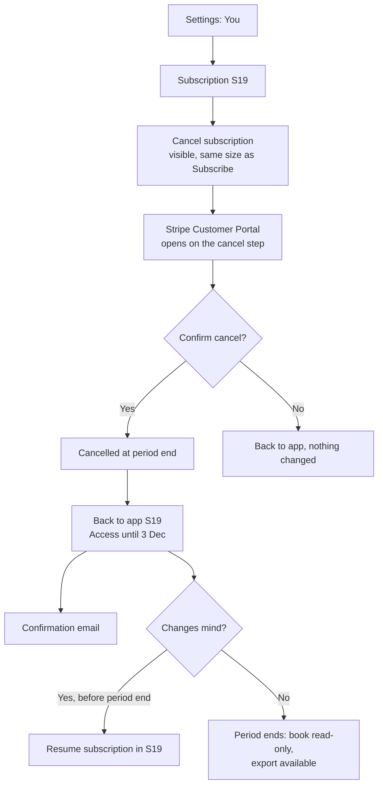
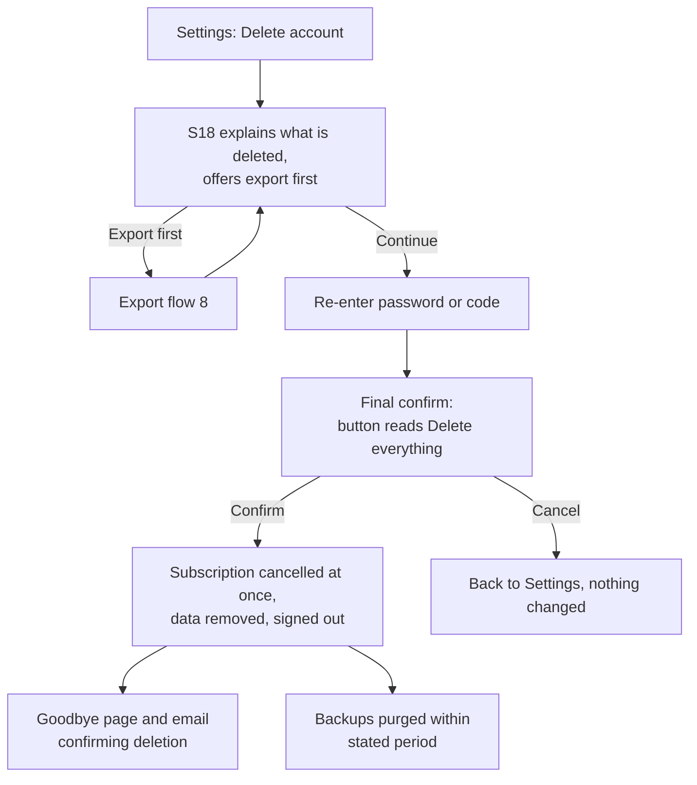

# D03: User Flows

**Product:** Endpaper
**Status:** Draft v0.1 for Reviewer and Product Owner (PO) review
**Date:** 2026-11-07
**Owner:** design-lead
**Spec source:** `docs/plan/manager-brief.md` (sections 2, 3, 7.2, 8)
**Related:** `D04-screen-inventory.md` (screen IDs S01..), `D04b-book-hub-spec.md` (page turn, chapters, date jump; written by the frontend lead), `D20-style-guide.md` (microcopy voice)

How to read this document: each flow has numbered steps, a diagram where the branching is hard to hold in your head, and a list of edge cases. Screen IDs such as **S09** point to the screen inventory (D04). Plain-language notes explain jargon the first time it appears. Items that depend on a technical decision still open in other deliverables (D5 architecture, D7 rewrite design, D8 privacy) are marked **[Depends on D5]** and so on. Anything I could not confirm from the brief or from sources is marked **[VERIFY]**.

---

## 0. Ground rules that apply to every flow

These are product decisions I am proposing so the flows below stay short. The PO can overrule any of them (see the open questions at the end).

| # | Rule | Why |
|---|---|---|
| G1 | **The user's words are never lost.** The transcript is saved on the device while recording, and on the server the moment the user taps End, before any AI work starts. | Journals are irreplaceable. The rewrite can fail; the transcript must not. |
| G2 | **The rewrite is always optional work done on top of the transcript.** If it fails or is slow, the user still has a page (showing the transcript) and can try again. | Keeps the nightly loop unbreakable. |
| G3 | **A page belongs to a "journal day", not a calendar date.** The journal day rolls over at **4:00 am local time**. A recording made at 12:40 am on Saturday belongs to Friday's page by default, and the user sees and can change the date before saving. | People journal late. Silently filing a 12:40 am entry under the next day feels wrong. The Reviewer flagged "which day is this entry" as a risk. |
| G4 | **People can always reach their own data.** When a trial ends or a subscription lapses, the book stays readable and exportable. Only recording and rewriting are paused. | Locking people out of their own diary is hostile and a trust risk. |
| G5 | **No guilt mechanics.** No streak counters, no "you missed 3 days" messages, no blank pages for days without an entry. Reminders and streaks are deferred features anyway. | Brief section 3 defers them; the tone guide forbids shaming. |
| G6 | **Every action gives visible feedback** (saved, updated, subscribed) and **every error says what to do next** (brief 8.3 items 11-13). | Brief quality bar. |
| G7 | **Consent is explicit and recorded.** Unticked boxes, plain disclosures, and the app stores which version of the Terms and Privacy Policy the user accepted and when. | Brief 8.1 items 5 and 11. |
| G8 | **A one-time "typed" fallback exists.** If the microphone cannot be used, the user can type or paste what happened instead, and the same rewrite runs. | Otherwise "mic blocked" is a dead end, and some users cannot or prefer not to speak. This is a small addition to the brief; flagged as an open question. |

**Navigation model used in the flows (mobile first):** a bottom bar with three places: **Book** (book hub, S06), **Record** (the big round Record button, goes to S09), **You** (settings, S15). On desktop the same three sit in a slim left or top bar.

---

## 1. Onboarding

**Goal:** a stranger goes from the landing page to their first recording-ready state with informed consent, a voice profile (or a conscious skip), and a clear idea of what happens to their words.

**Screens:** S01 Landing, S02 Sign up, S04 Check your email, S05 Writing samples, then S06 Book hub (empty state) or S09 Recording.

### 1.1 Flow chart

### 1.2 Numbered steps

**A. Sign up (S02)**

1. The visitor taps **Start free trial** on the landing page (S01). The button says what the trial is: "Start your 14-day free trial". No card is asked for at this point (recommendation; see open question Q3).
2. S02 asks for **email** and **password** (or just email, if the team chooses one-time codes) **[Depends on D5: auth methods]**.
3. Below the fields, in this order and in plain words:
   - **Required checkbox, unticked:** "I have read and agree to the [Terms of Service] and the [Privacy Policy]." Both are links that open in a new tab, so the form is not lost.
   - **Required checkbox, unticked:** the age confirmation. Recommended wording: "I am 16 or older." (See open question Q2 for the 13+ versus 16+ choice.)
   - **A short "what happens to your words" box**, not hidden in the Privacy Policy. Draft text: "When you record, your voice is sent to [transcription provider] to turn it into text. We do not keep the audio. Your text is sent to [AI provider] to write your page. Neither company may use your words to train its AI. Only you can read your book." The provider names are filled in once D5 picks them **[Depends on D5]**. The "may not train" sentence must be true in the signed vendor terms before launch **[VERIFY]**.
4. **Optional checkbox, unticked, separate:** none in v1. Marketing email consent is not asked for, because v1 sends only transactional email (receipts, trial reminders, export ready). If the PO wants a newsletter later, an unticked "Send me occasional news" box is added here (brief 8.1 item 10).
5. The **Create account** button is disabled until both required boxes are ticked. A disabled button must still be explained: a line under it says "Tick the two boxes above to continue" (read out to screen readers via `aria-describedby`).
6. On submit, the server creates the account and **stores the consent record**: the Terms version, the Privacy Policy version, the age confirmation, the timestamp, and the country or region if known. It does not store the IP address unless the privacy design requires it **[Depends on D8]**.
7. The user is moved to S04: "Check your email. We sent a 6-digit code to name@example.com." There is a **Resend** link (available after 30 seconds) and a **Use a different email** link.
8. After verification the user lands on S05.

**B. Sign in (existing user) (S03)**

1. Email and password, or email and code **[Depends on D5]**. Link: "Forgot your password?" (sends a reset link; the message is the same whether or not the email exists, so the form cannot be used to discover who has an account).
2. After sign-in the user lands on the book hub open at their latest page (see flow 5).
3. There is no consent checkbox on sign-in. If the Terms or Privacy Policy change materially, the next sign-in shows a one-time "We've updated our Terms" screen with the changes summarised and an **I agree** button (not pre-ticked). **[VERIFY with counsel whether v1 needs this]**.

**C. Paste writing samples (S05)**

1. Heading: "Show us how you write." Short line: "Paste a few things you've written, so your pages sound like you. Journal pages, long messages to friends, posts, anything in your own voice."
2. A large text area, with a live word counter. Guidance text beside it (collapsed on small screens): "A few paragraphs is enough. More is better. Please skip anything formal or written for work, and anything that contains other people's private details."
3. **Add another sample** adds another text area (up to a limit set by D7, for example 5 samples or 10,000 words in total) **[Depends on D7]**.
4. A privacy line right under the field, because samples are sensitive too: "Your samples are sent to [AI provider] only when we write your pages. They are never shared or used to train AI. You can delete them any time in Settings."
5. Two actions with equal visual weight:
   - **Save and continue** (disabled until at least the minimum amount is pasted; the minimum comes from D7, a placeholder of about 150 words total is assumed here).
   - **Skip for now** (a normal text button, never a hidden or shaming link).
6. On save, the samples are stored and the user moves to the book hub.
7. On skip, the user also moves to the book hub. Their pages will use a neutral voice (clear, plain, light edit) until they add samples.

**D. After onboarding**

1. The book hub shows the **first-day empty state** (S06): a closed book with the user's name, and one clear action: **Record tonight's page**.
2. If the user skipped samples, a single quiet line sits under the Record button: "Pages sound more like you once you add writing samples. Add some in Settings." It appears at most once per session and disappears for good after the user dismisses it or adds samples. No nagging.
3. A small "Day 1 of 14" trial indicator appears in Settings and on the Subscription screen (S19), not as a banner on every page.

### 1.3 Edge cases

| Case | Behaviour |
|---|---|
| User leaves the form with boxes unticked and presses Enter | The form does not submit. Focus moves to the first unticked required box and an inline message says which one is missing. |
| Email already has an account | Same neutral message as sign-in: "If this email has an account, we've sent a link." No account enumeration. |
| Code expired or wrong | "That code didn't work. It may have expired. Send a new one." Focus returns to the code field. |
| User closes the tab after signing up but before samples | Next sign-in resumes at S05 ("Pick up where you left off"). Skip is still available. |
| User under the minimum age | They cannot tick the age box, so the account cannot be created. No data other than what they typed (which is not sent anywhere) is collected. A short message links to the Terms. Do not ask for a birth date (data minimisation). |
| User in the EU or UK | Same flow. The explicit consent line matters more here. **[VERIFY with counsel]** whether journal content counts as special-category data (health, beliefs) under GDPR Article 9 and needs an additional explicit-consent sentence. See open question Q6. |
| Pasted samples contain very long text | Counter shows the cap; extra text is not silently cut. "That's more than we can use. We'll use the first [N] words." with a choice to trim. |
| Samples in another language | Allowed. The rewrite keeps the user's language **[Depends on D7]**. |
| User pastes someone else's writing | Not detectable, so the guidance text asks them not to. Terms cover it. |
| Screen reader user | Checkboxes are real checkboxes with visible labels. The disclosure box is a labelled region. Errors are announced politely. |
| Sign-up fails on the server | "We couldn't create your account just now. Nothing was saved. Please try again." Form content is kept. |
| Verification email never arrives | S04 shows a help section: check spam, resend, change email, contact support (mailto). |

---

## 2. Nightly recording

**Goal:** the user can speak freely for as long as they like, see their words appear, and end up with a saved transcript, even if the network or the browser misbehaves.

**Screens:** S06 Book hub, S08 Microphone explainer, S09 Recording, S10 Microphone blocked help, S22 Unfinished recording, then S11 Rewriting.

### 2.1 Flow chart

### 2.2 Numbered steps

1. **Entry point.** The user taps the round **Record** button on the book hub, or **Record** in the bottom bar. If it is before the usual hour, nothing changes; the app never blocks recording by time of day.
2. **Entitlement check (silent).** If the trial or subscription is active, continue. If not, S21 explains and offers **Subscribe**; the book stays open (rule G4).
3. **Unfinished recording check (silent).** If the device holds an unsaved draft transcript, S22 appears first (see 2.4).
4. **Recording screen, ready state (S09).** The screen shows:
   - The page date as a tappable chip: "Page for Friday, 6 November". Tapping it opens a small date picker. It defaults by rule G3 (4:00 am rollover). If a page for that date already exists, the chip says "Adding to Friday's page" (see 2.5).
   - One very large **Start** button (the custom record glyph, see D20).
   - A quiet hint: "Talk about your day. You can stop any time."
   - A small privacy line: "Audio is turned into text and not kept." **[Depends on D8: must match implementation]**.
5. **Microphone permission, explained first.** The very first time the user taps **Start**, the app does **not** call the browser permission prompt straight away. It shows S08, a short sheet:
   - Title: "Before the browser asks about your microphone"
   - Body: "Endpaper listens only while you're recording. Your voice goes to [transcription provider] to be turned into text, and the audio is not kept. You can stop at any time."
   - Buttons: **Continue** (then the browser prompt appears) and **Not now** (closes the sheet; nothing is requested, no dead end).
   - This is the "pre-permission" pattern. It matters because if a user denies the browser prompt, many browsers will not ask again and recovery is hard.
6. **Browser prompt.** The browser asks for microphone access. The app shows a calm waiting state ("Waiting for your browser...") so the screen is never blank behind the prompt.
7. **Allowed:** the Start button becomes active (or recording starts straight away, since the user already tapped Start; recommendation: start recording immediately after Allow to avoid a second tap).
8. **Recording (S09, live state).**
   - The Start button turns into **End** (a different custom glyph and a different shape, not just a different colour, so it works for colour-blind users and screen readers).
   - A running timer shows elapsed time.
   - A gentle level indicator shows the app is hearing the voice. If no sound is detected for 8 seconds it says "We can't hear you. Is your microphone muted?" (not an error screen).
   - The **live transcript** appears in the book serif as words arrive. It scrolls to keep the newest line in view, but stops auto-scrolling if the user scrolls up to look back, and shows a "Jump to latest" button.
   - Screen readers: the transcript is **not** read out word by word (that would be unusable). A visually hidden live region announces only state changes: "Recording started", "Recording ended, transcript saved", "Connection lost, your words are kept", "Back online". The transcript text itself is a normal region the user can read on demand.
   - The screen is kept awake where the browser allows it (Wake Lock) **[VERIFY: support on iOS Safari and in installed PWAs]**.
   - A secondary **Discard** text button sits well away from End. It asks "Throw away this recording?" with **Keep recording** as the default focused choice.
9. **Ending.** The user taps **End**.
   - Recording stops at once.
   - The transcript is saved to the server (it was already saved on the device throughout). The button shows "Saving..." then "Saved".
   - The user can **edit nothing** on this screen; editing happens in the entry view. The app moves straight to S11 Rewriting. If the transcript is empty or under a minimum length (for example fewer than 10 words), the app asks "That was very short. Save it as it is, or record a little more?" with **Save as it is** and **Keep going** **[Depends on D7: short input handling]**.
10. **Rewriting begins** (flow 3).

### 2.3 Microphone blocked (S10)

Triggered when the browser reports permission denied, no microphone is found, or the microphone is in use by another app.

1. S10 replaces the Start area. Heading: "Endpaper can't hear you yet."
2. Short explanation of the specific cause, with the right instructions for the user's browser, detected where possible:
   - **iPhone Safari:** Settings, then Safari, then Microphone, set to Ask or Allow; or the "aA" menu in the address bar, Website Settings, Microphone. In an installed home-screen app, iOS Settings, then the app name. **[VERIFY exact iOS menu names for current iOS versions on a real device]**
   - **Android Chrome:** the padlock or tune icon in the address bar, Permissions, Microphone, Allow. **[VERIFY]**
   - **Desktop:** the padlock icon next to the address, Microphone, Allow. **[VERIFY]**
3. Actions: **Try again** (re-checks permission without reloading the page), **Type your day instead** (opens the typed entry, see below), **Contact support**.
4. If no microphone device exists: "We can't find a microphone on this device. Plug one in, or type your day instead."
5. If another app holds the microphone: "Another app may be using your microphone. Close it and try again."

**Typed entry (fallback, rule G8):** a plain text area in the book serif labelled "Type or paste what happened today". **Save and write my page** saves the text as the transcript (marked as "typed" internally, so the entry view can say "Original text" instead of "Original transcript") and continues to S11. This reuses the whole rewrite pipeline and costs very little extra to build.

### 2.4 Crash and disconnect recovery (S22)

How it works for the user: the app saves the in-progress transcript on the device every few seconds (the saved copy lives in the browser's own storage on that device, and is deleted once the server has confirmed the transcript).

1. The user reopens Endpaper after a closed tab, a crash, a dead battery or lost connection.
2. Before showing the book hub or recording screen, the app finds the unsaved draft and shows S22: "We kept your recording from Friday, 11:42 pm (about 6 minutes)." It shows the first lines of the draft so the user recognises it.
3. Actions: **Finish it** (saves the draft transcript to the server as if End had been tapped, then moves to S11), **Keep recording** (resumes adding to it, where the transcription method allows) **[Depends on D5]**, **Discard** (asks for confirmation).
4. The draft is never deleted automatically without the user choosing, except when the user signs out; on sign-out the app warns "You have an unsaved recording on this device. Finish it first, or discard it." (so the next person using a shared device cannot read it).

### 2.5 A second recording on the same day

1. If a page already exists for that journal day, S09 says "Adding to Friday's page".
2. The new transcript is **added** to the day's transcript as a new section, and only the new section is rewritten and added after the existing rewrite. Existing edits are never overwritten **[Depends on D7: confirm the append-and-rewrite-the-new-part approach]**.
3. The page stays one page per day (brief 2.1). This avoids a pile of tiny pages and keeps the page-turn metaphor honest.

### 2.6 Offline

1. **Offline before Start:** S09 shows a banner: "You're offline. Recording needs a connection to turn speech into text." If the final technical design supports local buffering, this changes to "You can still record. We'll turn it into text when you're back online." **[Depends on D5: cloud versus in-browser transcription and iOS Safari support]**. The **Type your day instead** option is always available and works offline; the typed text is saved on the device and sent when the connection returns.
2. **Connection lost during recording:**
   - A non-blocking banner appears: "You're offline. What you've said so far is saved on this device." (announced to screen readers).
   - If audio can be held on the device while offline **[Depends on D5]**, the recording continues, the transcript shows "Catching up when you're back online...", and the audio is turned into text once the connection returns. The temporary audio copy is deleted as soon as it is transcribed (brief 8.1 item 6).
   - If audio cannot be held, recording pauses visibly: "We've paused because there's no connection. Your words so far are safe. We'll keep trying." On reconnect the user chooses **Keep recording** or **End and save**.
3. **Offline at End:** the transcript is saved on the device and the app shows "Saved on this device. It will sync when you're back online." A small indicator on the book hub shows pending items. Nothing is lost, and nothing pretends to be synced when it is not (never show a false "Saved").
4. **Back online:** the saved transcript uploads automatically; rewriting starts; a toast says "Back online. Your page is being written."

### 2.7 Edge cases

| Case | Behaviour |
|---|---|
| Phone screen locks or the user switches apps (iOS Safari can stop the microphone in the background) | The recording may stop. On return the app says "Recording stopped when you left the app. Your words so far are saved." and offers **Keep recording** or **End and save**. A line in Help explains it. **[VERIFY behaviour on real iOS devices; brief 8.3 item 20]** |
| Very long recording (for example 60+ minutes) | The transcript keeps saving in parts. The hard cap, if any, comes from D5 (server time limits). At 90% of the cap a gentle notice appears: "You've been talking a while. Tap End to save this part; you can keep going on the same page afterwards." |
| Phone call or notification interrupts | Treated like backgrounding above. |
| Two devices recording at once | Allowed, but the second recording for the same day is added as a second section (2.5). |
| The user taps End by accident | The transcript is saved, not lost. They can add more to the same page straight away (2.5). That is why End has no scary confirmation. |
| User taps Discard by accident | Confirmation protects it; the default focus is **Keep recording**. |
| Background noise or another voice | Transcription is not perfect. The transcript is editable (flow 4). The rewrite prompt must not follow instructions spoken in the audio (prompt-injection safeguard) **[Depends on D7]**. |
| The browser has no speech support | Falls back to **Type your day instead** with an explanation. |
| User denies permission, then later enables it in settings | **Try again** on S10 detects the change without a page reload. |
| Two draft recordings on the same device | S22 lists them, newest first. |
| Quiet recording (no speech detected at all) | "We didn't catch anything. Check your microphone, or type your day instead." No empty page is created. |
| Free tier / provider outage | If transcription is unavailable the user sees "Transcription is having a problem right now" and the typed fallback. Words already captured are kept. |

---

## 3. Rewrite wait and result

**Goal:** the moment after End feels crafted rather than empty, and the user understands that the transcript is already safe.

**Screens:** S11 Rewriting, then S12 Entry view.

### 3.1 Flow chart

### 3.2 Numbered steps

1. Right after End, the app shows **S11**: a crafted "writing your page..." state on a blank page of the book (not a bare spinner; see D20 for the motion). Text: "Writing your page." Underneath, smaller: "Your words are saved. This takes about 10 seconds." **[Depends on D7 for the real duration]**.
2. The state shows the real page frame (date, ruled or plain paper) so that the result appears in the same place, avoiding a jump.
3. If the rewrite **streams** (text arrives as it is written), the words appear on the page as they come **[Depends on D5/D7]**. If not, the crafted wait state stays until the full result is ready. Either way, no layout shift.
4. Screen readers hear one polite announcement: "Writing your page." then "Your page is ready." The finished text is not read aloud automatically.
5. **Result:** S12 opens on today's page showing the rewritten entry. A short toast says "Saved to your book" (it fades; the same text is available to assistive tech via a status region). The original transcript is one tap away (flow 4).
6. A subtle one-line prompt appears the **first** time only: "Not quite you? Edit anything, or tap Original to see what you said." After that it never shows again.
7. The user may leave S11 at any time. The rewrite continues on the server. When they next open the book, the page is there. If it finished while they were away, a small note on the page says "Written just now".

### 3.3 Edge cases

| Case | Behaviour |
|---|---|
| Rewrite takes longer than 20 seconds | Text changes to "Still writing. This one is long. You can leave; your page will be in your book." |
| Rewrite fails (AI provider error, timeout) | The page is created showing the **transcript** with a clear marker: "We couldn't write this page yet. Your words are saved." Buttons: **Try again** and **Leave it for now**. The app also retries once automatically in the background. |
| Rewrite rate limit or cost limit reached for this user | "Too many rewrites in a short time. Try again in a few minutes." (Limits protect against cost abuse; set by D9/D7.) |
| Very short transcript | The result may be little changed. The app does not invent content to fill the page. A note under the entry says "This was a short one, so we kept it close to your words." **[Depends on D7]** |
| Very long transcript | May be split into parts by the system; the user sees one page. If the page is longer than a screen, it scrolls within the page. |
| Rewrite changes meaning | The user can always compare to the original and edit. Terms include an AI-accuracy disclaimer. |
| Offline when End was tapped | See 2.6. The wait state appears only once the transcript is on the server. |
| The user's trial ended between Start and End | The transcript is still saved and the rewrite still runs for this one entry (do not punish a user mid-sentence). The next Start shows S21. |
| Reduced motion | The animated writing state becomes a static page with the text "Writing your page..." and a slow fade, no movement. |

---

## 4. Review and edit

**Goal:** the user can read the finished page, flip to what they actually said, fix either, and undo mistakes.

**Screens:** S12 Entry view, S13 Entry edit, S14 Revision history.

### 4.1 Flow chart

### 4.2 Numbered steps

**Reading and toggling**

1. S12 shows the page: the date as a page heading, the rewritten entry in the book serif, and a two-option **segmented toggle** at the top of the page: **Rewrite | Original**. (A toggle, not two separate pages, so the user keeps their place. The toggle is a pair of real buttons with `aria-pressed`, operable by keyboard.)
2. Tapping **Original** swaps the text for the transcript in place. The page is labelled "What you said" so it is never confused with the polished version. For typed entries it reads "What you typed".
3. The toggle remembers the last choice per session only (not forever) so the default reading experience is always the rewrite.
4. Below the text: **Edit**, **History**, and an overflow menu with **Rewrite again from the original** and **Delete this page**.

**Editing either version**

5. Tapping **Edit** opens S13 for **whichever version is showing**. The text becomes an editable area in the same book serif, so what you edit looks like what you read. A clear **Save** and **Cancel** appear (sticky at the bottom on mobile, above the keyboard).
6. While editing, a draft is kept on the device so a crash or accidental swipe does not lose changes.
7. **Save** stores a new version, shows "Saved", and returns to S12. The page can never end up empty by accident: saving an empty rewrite asks "This would leave the page blank. Save anyway?"
8. **Cancel** with unsaved changes asks "Throw away your changes?" with **Keep editing** as the focused default.
9. Editing the original transcript does **not** automatically rewrite the page. After saving a changed transcript, the app offers, once: "You changed what you said. Write this page again from your edited words?" with **Write again** and **Not now**. This keeps user edits to the rewrite safe by default.

**Revision history (S14)**

10. **History** opens a list of saved versions for the entry: the AI's first rewrite (always kept, labelled "First draft by Endpaper"), each later save with its date and time, and which part changed (Rewrite or Original).
11. Tapping a version previews it read-only next to the current text, with changed words softly marked. On a phone, preview replaces the page temporarily.
12. **Restore this version** makes it the current text and, importantly, **adds a new version** rather than deleting later ones, so history only grows. A toast confirms: "Restored. Your earlier version is still in History."
13. Storage rule: keep every version for the first 30 days, then keep the most recent 20 per entry **[Depends on D6/D9: confirm limit and storage cost]**.

**Rewrite again**

14. From the menu, **Rewrite again from the original** warns: "This replaces your current rewrite with a new one. The current one is saved in History." Buttons: **Rewrite again** and **Cancel**. Then S11 runs. Limited per day to prevent runaway cost **[Depends on D7/D9]**.

**Delete a page**

15. **Delete this page** is a separate, clearly worded action: "Delete this page? This removes the rewrite, the original and all earlier versions. This can't be undone." The button names the action ("Delete page"), not "Yes". Export is offered in the same dialog.

### 4.3 Edge cases

| Case | Behaviour |
|---|---|
| Edit made while offline | Saved on the device, marked "Not synced yet", synced later. If the server copy changed meanwhile (edit on another device), the user is shown both and chooses; nothing is overwritten silently. |
| Two devices edit at once | Last save wins is **not** acceptable. Use version numbers; on conflict show both. **[Depends on D6]** |
| Very long entry | Edit area grows; text stays at the reading width (see D20). |
| User wipes the whole text | Confirmation (step 7). |
| Pasting formatted text | Pasted as plain text; v1 pages have paragraphs only, no bold or images (photos are deferred). |
| Reduced motion | The toggle swap is instant. |
| Screen reader | The toggle announces "Rewrite, pressed" or "Original, pressed". The text region has a label that names the version being shown, so it is never ambiguous. |
| Spell-check | Left to the browser. |
| Entry created by "Type your day instead" | Original is labelled "What you typed". |
| Transcript contains a mishearing | The user edits the Original and optionally rewrites again. |

---

## 5. Browsing the book

**Goal:** a returning user lands where they expect (today), and can move through time by turning pages, by chapter, or by jumping to a date. The detailed behaviour of the book itself is in **D04b-book-hub-spec.md** (frontend lead); this flow only says when and why users move.

**Screens:** S06 Book hub (closed cover and open book), S07 Contents and date jump, S12 Entry view.

### 5.1 Flow chart

### 5.2 Numbered steps

1. **Open to today.** On opening the app, the book opens to **today's page** if it exists, otherwise to the **latest page**. If the user has not recorded today yet, the right-hand side shows today's date and a gentle **Record tonight's page** button (it is not a blank "missed day" page; see rule G5).
2. **First visit.** The closed cover is shown once with the book's title (the user's name, for example "Maya's book") and an **Open** control. After the first opening, returning users skip the cover and land on a page. Whether the cover is a destination users can return to (a "Close book" action) is detailed in D04b.
3. **Turn pages.** Previous and next work by: swipe or drag on the page, tapping the page edge, the on-screen arrows, and the left and right arrow keys on a keyboard. All are real buttons or key handlers, with visible focus, so the page turn is fully keyboard-operable (brief 8.1 item 19). The page turn is the single signature animation; with reduced motion it becomes a quick crossfade or an instant swap.
4. **Pages exist only for days with an entry.** Turning past a gap simply goes to the next written day; the date at the top shows the jump ("Monday 2 November") so the user is never confused.
5. **Chapters by month and year.** The contents sheet (S07) lists years, each expandable into months, each with the number of pages. Picking a month opens a **chapter opening page** (month name, year, page count), followed by the first page of that month. This mirrors a real book: the months are the chapters.
6. **Jump to a date.** The contents sheet also has a date control: a calendar where days with pages are marked (by a small mark that does not rely on colour alone). Picking a day with a page turns straight to it. Picking a day without one says "No page for 12 October. Nearest pages: 11 October, 14 October" with two buttons.
7. **Open an entry.** Tapping the page text, or a clear **Read and edit** control, opens S12 (flow 4). Back returns to the exact same place in the book.
8. **Thumb reach.** The primary controls (previous, next, contents, record) sit in the lower half of the screen on phones.
9. **Search** is not in v1.

### 5.3 Edge cases

| Case | Behaviour |
|---|---|
| Brand-new user, no pages | Closed book, empty state with one action (Record). No empty ruled pages. |
| One page only | Previous and next are disabled and say why to assistive tech ("This is the first page"). |
| Thousands of pages after years of use | Pages are loaded in small batches around the current one; contents and date jump work without loading everything. Detail in D04b. |
| Slow connection | The book frame renders at once; pages show **layout-matched skeletons** (ruled lines where the text will go), never a bare spinner. |
| Page failed to load | Inline "This page didn't load. Try again." on that page; the rest of the book keeps working. |
| Offline | Recently opened pages remain readable if cached; otherwise "You're offline. Pages you haven't opened recently aren't available." |
| Trial ended | The book is fully readable (rule G4); Record shows S21. |
| Reduced motion | No page-turn animation, instant or crossfade only. |
| Dark (night) mode | The book uses the night palette (see D20); texture is kept at lower strength. |
| Timezone change (travel) | Pages stay on the date they were created for; new entries use the current timezone. A page never moves dates silently. |
| Desktop wide screen | A two-page spread (details in D04b). |

---

## 6. Subscribe

**Goal:** a trial user can become a paying subscriber in a few taps, knowing exactly what they will pay and when.

**Screens:** S19 Subscription, S20 Payment result, Stripe Checkout (hosted by Stripe), S21 Trial ended.

### 6.1 Recommended offer (for the PO to confirm)

| Item | Recommendation | Reason |
|---|---|---|
| Trial length | **14 days** (within the 7 to 14 days range in the brief) | Habits need about two weeks to show. After 14 nights a user has a real book, which is the strongest reason to stay. It also matches the PO's own two-week dogfooding plan (D12). |
| Card up front? | **No card needed to start the trial** (open question Q3) | Lowest friction and highest trust for an app that holds diaries. Trade-off: fewer automatic conversions than card-up-front trials **[VERIFY with industry data before deciding; I have no verified figures]**. |
| Plans | **One plan, two intervals:** monthly and yearly (yearly discounted). Exactly **two** options on screen, not three tiers (brief 8.2). | Brief section 3. |
| Price | Monthly in the brief's range (about $5-8); yearly at a visible discount. Exact numbers are a PO decision (open question Q4) and come from D9. | |
| Taxes | The price shown includes or clearly excludes tax, and Stripe Checkout shows tax before paying **[VERIFY: enable Stripe Tax and test per region]** | Brief 8.1 item 12. |

### 6.2 Flow chart

### 6.3 Numbered steps

1. **Where the user sees the offer:** on S19 (from Settings, "Subscription"), in the quiet trial indicator, in the reminder email, and on S21 when the trial has ended. There is no pop-up and no countdown timer.
2. **S19 contents (trial):** "Your trial: day 9 of 14. Ends 21 November." Under it, two plan choices: **Monthly: $X per month** and **Yearly: $Y per year (that is $Z per month, saves N%)**. Neither is pre-selected in a way that hides the other; the yearly one is shown first only if the PO agrees (open question). A line states: "You won't be charged until your trial ends on 21 November. Cancel any time."
   - If the trial needs no card: "Add a payment method to keep recording after 21 November."
3. **Subscribe:** the button reads **Continue to payment** and sends the user to **Stripe Checkout**, a page hosted by Stripe. The payment details never touch Endpaper's servers. The chosen plan and price are repeated on the Checkout page.
4. **Before they leave:** a one-line note says "You're going to Stripe, our payment provider, to pay securely."
5. **Success:** Stripe returns the user to **S20**: "You're subscribed. Thank you. Your next payment is $X on [date]." with a **Back to my book** button. A confirmation email (the Stripe receipt plus an Endpaper confirmation) follows.
6. **Entitlement:** the app grants access only after the **Stripe webhook** confirms the payment and updates the subscription record in Supabase. S20 therefore may briefly say "Confirming your payment..." until the webhook arrives (usually seconds) with a polite live region. The user is not blocked meanwhile: if the webhook is late, S20 says "Your payment went through. It can take a minute to show up. You can keep using Endpaper."
7. **Reminder email before the trial ends (brief 8.1 item 3):** sent **3 days before** the trial ends. It states the end date, what happens (no charge unless they subscribe, or the exact charge date and amount if a card is on file), and has two links: **Subscribe** and **How to cancel** (for card-on-file trials this goes straight to the cancellation page). Plain text sits alongside the designed version. Stripe fires a "trial will end" event about three days before the end of a trial, which the app can use to send this email **[VERIFY against current Stripe docs]**.
8. **Yearly renewal reminder:** an email **before each yearly renewal** with date, amount and how to cancel. Lead time: **7 days** is proposed; some jurisdictions or card networks may require more **[VERIFY with counsel; do not assume]**. Monthly plans get a receipt each month and a link to manage billing.
9. **Trial ended (S21):** "Your trial has ended. Your book is still yours and you can read it and export it any time. To keep recording, subscribe." Buttons: **Subscribe**, **Export my book**, **Read my book**. No dark pattern: no confirmshaming copy, no fake urgency, no hidden decline link.

### 6.4 Edge cases

| Case | Behaviour |
|---|---|
| User abandons Checkout | Returned to S19. Nothing charged. Message: "No payment was made." |
| Card declined | Stripe's page explains. The app shows nothing extra. |
| Payment fails on renewal | Stripe retries per its settings **[VERIFY schedule]**. The app shows a quiet banner: "We couldn't take your payment. Update your card to keep recording." with a link to the Customer Portal. After a short grace period (proposal: 7 days) recording pauses; the book stays readable and exportable (rule G4). A failed-payment email is sent. |
| Webhook delayed or duplicated | The app tolerates both (verified signature and idempotent handling; engineering detail in D5). The user sees the "can take a minute" message at worst. |
| User subscribes twice (two tabs) | Second attempt shows "You're already subscribed." |
| Taxes or currency | Shown at Checkout in the user's currency where Stripe supports it **[VERIFY]**. |
| Refund request | Per the Refund and Cancellation Policy (S27). Handled by email in v1. |
| Switch plan (monthly to yearly) | Done in the Customer Portal; proration shown there. |
| Trial abuse (many accounts) | Out of scope for v1 UX; flagged for D11. |
| Screen reader | Plan choice is a radio group with price in each label. The total and date are in text, not only in a graphic. |
| User in a country Stripe or the app does not support | Message at signup or checkout: "Endpaper isn't available there yet." **[VERIFY supported countries]** |

---

## 7. Cancel

**Goal:** cancelling is as easy as signing up (brief 8.1 item 3 and 11). No hidden path, no maze, no guilt.

**Screens:** S19 Subscription, Stripe Customer Portal (hosted by Stripe), S20 Payment result (cancel confirmation state).

### 7.1 Flow chart

### 7.2 Numbered steps

1. **Findable in two taps.** From any screen: **You** (bottom bar), then **Subscription**. The **Cancel subscription** button is on that screen, always visible when a subscription or trial is active, in the same size and prominence as the **Subscribe** button. It is not hidden in a menu, a footer link, or behind a "contact us" step.
2. **One click to the cancel step.** The button opens the **Stripe Customer Portal**, deep-linked to its cancellation step **[VERIFY: Stripe's portal supports opening directly on the cancel flow with `flow_data`]**. The user confirms, and Stripe processes it.
3. **Portal configuration:** cancel **at period end** (the user keeps what they paid for) is the default. Cancellation reason survey: optional and skippable, or off. No discount offers, no multiple confirmation screens, and no copy that guilt-trips.
4. **Return to the app** with a clear confirmation (S19 cancelled state): "Your subscription is cancelled. You keep full access until 3 December. After that your book stays readable and you can still export it." An email confirms the same.
5. **Changed their mind:** until the period ends, S19 shows **Resume subscription** (one click, no new payment, since they have already paid for the period).
6. **After the period ends:** rule G4. Read-only book, export, delete account; recording disabled; **Subscribe** to return.
7. **Cancelling during a trial:** the same button. It ends the trial at once or at the trial end date; recommendation: keep access until the trial end date since the user has not paid for anything and the generosity is cheap. If no card is on file there is nothing to cancel: S19 just says "Nothing is scheduled to be charged".
8. **Plan changes and payment methods:** "Manage billing" opens the Customer Portal for invoices, card changes and plan switching. This is separate from Cancel so that cancellation never needs to be found among billing options.
9. **Refunds:** the Refund and Cancellation Policy (S27) states the rule. The link to it is on S19, near the cancel button.

### 7.3 Edge cases

| Case | Behaviour |
|---|---|
| Portal fails to load | "We couldn't open the billing page. Please try again, or email [contact] and we'll cancel it for you today." |
| Cancel clicked twice | Idempotent; confirmation shown again. |
| User cancels in Stripe emails or in the portal directly | The webhook updates the record; S19 shows the same cancelled state on next open. |
| User deletes their account while subscribed | The active subscription is cancelled automatically **immediately**, no further charge, and the user is told in the delete flow (flow 9). |
| Subscription past due, then user cancels | Cancel is immediate; no further retries. |
| Screen reader | The cancel button has a name that says what it does: "Cancel subscription". The dialog on return announces the access end date. |
| Pre-renewal reminder not received | The date and cancel link are always visible on S19 as well. |

---

## 8. Export

**Goal:** the user can take everything with them, any time, without asking anyone (brief 8.1 item 9).

**Screens:** S17 Export data. Triggered from Settings and from S21.

### 8.1 Numbered steps

1. **Settings, then Export my data** opens S17. Plain explanation: "Download everything you've written in Endpaper: your pages, your original transcripts, your writing samples and your account details."
2. **Choose a format** (checkboxes, all independent):
   - **Text** (one readable file per page, or one combined file, as a zip) for reading anywhere.
   - **JSON** (everything, structured, for moving to another tool).
   - **PDF** (a printable book) **optional in v1** (open question Q5; the brief lists "text/PDF/JSON").
3. **Request export.** For a small book, the files are prepared on the spot with a progress state ("Packing your book...") and a download starts. For a large book, the page says "We're preparing your export. We'll email you a link when it's ready, usually within a few minutes." The email link is private to the account, requires sign-in, and expires after **24 hours** (proposal). The email contains no journal content.
4. **Recent-sign-in check.** If the user last signed in more than 15 minutes ago, they confirm their password or a code first. This protects a diary on a shared phone.
5. **What is included** is listed on S17 so nothing surprises: all pages with dates, rewrite and original text, current versions (history optional via a toggle "Include earlier versions"), writing samples, account profile and consent record. Raw audio is not included because it is not kept.
6. **Success:** "Your export is ready. Download." with the file size and what's inside.

### 8.2 Edge cases

| Case | Behaviour |
|---|---|
| Empty book | Export still works and contains the profile and samples; the message says there are no pages yet. |
| Export fails | "We couldn't prepare your export. Nothing was changed. Try again, or contact us and we'll send it by hand." |
| Rapid repeated requests | One export at a time, with a short cooldown, to limit abuse and cost. |
| Large book (years of entries) | Handled in the background; email link (step 3). |
| Subscription lapsed | Export remains free and available (rule G4). |
| Link expired | Request again; no data lingers in storage beyond the stated window, and the temporary file is deleted after expiry **[Depends on D8]**. |
| Accessibility | Progress is announced politely; download button has a clear name and file size. |

---

## 9. Delete account

**Goal:** permanent, understandable, and not hidden. Deletion covers database, storage and backups within a stated period (brief 8.1 item 9).

**Screens:** S18 Delete account.

### 9.1 Flow chart

### 9.2 Numbered steps

1. **Settings, then Delete account** (placed in a clearly labelled "Danger zone" style section at the bottom, in plain words, not hidden).
2. **S18** says what happens, in a short list of plain sentences (not a checkmark list):
   - Your pages, original transcripts, writing samples and account details will be deleted permanently.
   - Your subscription, if you have one, will be cancelled right now and you won't be charged again.
   - We can't recover anything afterwards.
   - Copies in our backups are removed within **[30] days** **[Depends on D8; VERIFY against Supabase backup retention]**.
   - Records we must keep by law (for example payment records held by Stripe) are not deleted by us and are explained in the Privacy Policy.
3. **Offer export first**: "Want a copy first? Export my book." (a normal link to flow 8, not a blocker).
4. **Confirm identity**: password or one-time code.
5. **Final confirmation**: the user types nothing unusual; the button is plainly named **Delete my account and all my pages**, next to **Keep my account** (focused by default). I recommend a single confirmation, not a gauntlet of screens.
6. **Do it**: the server cancels the Stripe subscription immediately, deletes the user's data from the database and storage, removes the Stripe customer record where possible, ends all sessions, and sends a confirmation email (to the address, with no journal content).
7. **Goodbye page**: "Your account has been deleted. Thank you for trying Endpaper." with a link to the landing page.
8. **Backups** are purged within the stated period; the Privacy Policy and S18 both state it.

### 9.3 Edge cases

| Case | Behaviour |
|---|---|
| Deletion fails midway | Treated as one operation with a retry job. The user sees: "We couldn't finish deleting your account. We've been alerted and will complete it; you'll get an email when it's done." The account is locked in the meantime so it cannot be used halfway. |
| Active subscription | Cancelled and not charged again (flow 7 edge case). |
| User changes mind after deleting | Not possible; stated plainly. (Alternative with a 7-day undo window: open question Q7.) |
| Shared device | Sign-out and local draft cleanup happen as part of deletion. |
| Legal hold or abuse investigation | Out of scope for v1 UX; counsel to confirm any retention **[VERIFY]**. |
| Screen reader | The destructive button has a name that states exactly what it does; the dialog is a proper alert dialog. |

---

## 10. Cross-flow: emails the flows depend on

All are **transactional** (no marketing in v1), sent from a separate sender identity than any future marketing mail (brief 8.1 item 10). None contain journal text.

| ID | Email | Trigger | Key content |
|---|---|---|---|
| E01 | Verify your email | Sign up | Code or link, expiry time, "if this wasn't you, ignore this". |
| E02 | Welcome | After verification | What to do tonight, trial end date, link to Help. Short. |
| E03 | Trial ends soon | 3 days before trial end | End date, what happens, Subscribe link, how to cancel. |
| E04 | Subscription confirmed | After first payment | Plan, amount, next charge date, manage-billing link. (Stripe also sends its own receipt.) |
| E05 | Yearly renewal coming | About 7 days before yearly renewal **[VERIFY lead time]** | Date, amount, cancel link. |
| E06 | Payment failed | Failed renewal | What to do, link to the Customer Portal. |
| E07 | Subscription cancelled | After cancel | Access-until date, how to resume. |
| E08 | Export ready | Large exports | Private link, expiry. |
| E09 | Account deleted | After deletion | Confirmation and the backup-purge date. |
| E10 | Password reset or sign-in code | Request | Link or code. |

Every email carries the business name and contact address in the footer (brief 8.1 item 15).

---

## 11. Open questions for the Product Owner

| # | Question | My recommendation |
|---|---|---|
| Q1 | Are the cross-cutting rules in section 0 acceptable, in particular the **4:00 am journal-day rollover** and the **append a second recording to the same day's page** behaviour? | Yes to both. They solve the "recorded after midnight" and "recorded twice" cases without extra screens. |
| Q2 | **Age gate:** the brief says 13+ (16+ where local law requires). Asking for the country at signup adds friction and data. Should v1 simply require **16+ for everyone**? | Require 16+ globally in v1 and say so in the Terms. It is simpler, safe in the EU and UK, and costs few users. Revisit in a later phase. If the PO wants 13+, add a country question and apply 16 only where required **[VERIFY per country with counsel]**. |
| Q3 | **Trial with or without a card?** | No card for the 14-day trial: best for trust and activation in a diary app. Reminder email still goes out 3 days before the end. Accept lower automatic conversion. |
| Q4 | **Price points and which plan is shown first.** | Decide with D9. Show both plans side by side, no pre-selected "best value" badge that hides the other. |
| Q5 | **Export formats:** the brief says text/PDF/JSON. | v1: text and JSON. PDF as a fast follow, because a good-looking PDF book is a design task of its own. |
| Q6 | Journal text can reveal health, beliefs or sexuality. Under GDPR this may be **special-category data** requiring explicit consent wording. | Ask counsel before launch **[VERIFY]**. In the meantime the draft wording on S02 is deliberately explicit about what is collected and why. |
| Q7 | **Delete account: immediate and permanent, or a 7-day undo window?** | Immediate and permanent, with a prominent export offer first. Simpler and honest. A 7-day undo is kinder but holds data longer and adds a state. |
| Q8 | **Typed-entry fallback** ("Type your day instead") is a small addition not in the brief. | Include it. Without it, "microphone blocked" is a dead end and the product excludes people who cannot speak aloud. |
| Q9 | **Reminder time:** the brief's Settings wireframe lists "reminder time" (screen 9), but reminders are a deferred feature (section 3). | Show it in the wireframe marked "Later" so the PO can see it, but do not build it in v1. A dead control in production is forbidden (brief 8.3 item 11). |
| Q10 | **Failed-payment grace period** (proposal: 7 days of continued access) and **version history limits** (30 days of all versions, then the latest 20). | Accept both as defaults; revisit with real cost data from D9. |
| Q11 | **Trial start date:** clock starts at sign-up (proposed) or at the first saved page. | Sign-up. It is simpler to explain ("Day 3 of 14") and cannot be gamed. |
| Q12 | **Wake Lock, offline buffering and iOS Safari behaviour** are uncertain until the real-device test (brief 8.3 item 20). | Treat the offline-buffering promise as conditional: write the copy for the weaker case ("paused, words safe") until D5 confirms the stronger one. |

---

## 12. [VERIFY] list for this document

- Whether the Stripe Customer Portal can open directly on the cancellation step, and how Stripe's "trial will end" event timing works.
- iOS and Android microphone-permission menu names and wording on current OS versions.
- Wake Lock support on iOS Safari and in an installed PWA.
- Whether v1 needs a "terms changed" re-acceptance screen.
- Age and consent requirements per country, and whether journal content is special-category data.
- Required lead time for yearly renewal reminder emails in each market.
- Stripe retry schedule for failed payments and supported countries.
- Backup retention in Supabase versus the stated deletion period.
- Whether the transcription and AI vendors' signed terms really forbid training on user data.
