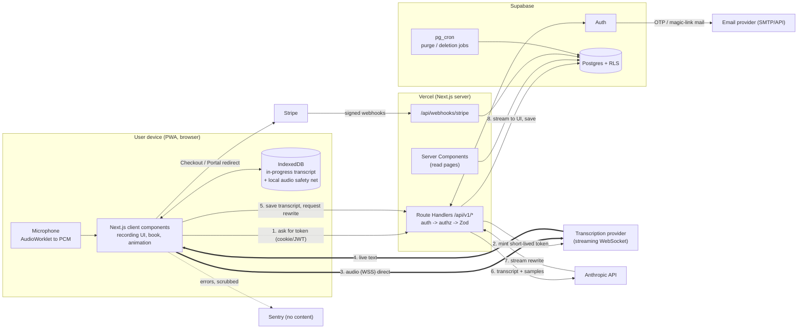

# D5. Architecture and stack

**Status:** Draft for PO review · **Owner:** Backend Lead · **Reviewer audit:** required
**Verification note:** this session could reach only a web-search tool, not vendor sites directly. Vendor facts below come from search summaries and my own knowledge. Anything not confirmed on an official page is marked **[VERIFY]**. Check each before Phase 3.

## 1. The big picture in plain words
- **Next.js on Vercel** is the app and its "back office". The pages the user sees run in the browser. Anything secret (AI, payments, issuing transcription permission slips) runs in Vercel *server functions*: small programs that start on demand, do one job, then stop.
- **Supabase** is the filing cabinet: a Postgres database, sign-in (Auth), and file storage. **Row-Level Security (RLS)** means the database itself refuses to show one user's rows to another user, even if our code has a bug.
- **Stripe** handles money. We never touch card numbers. Stripe tells us what happened through **webhooks** (automatic messages), and we copy the result into Supabase.
- **Anthropic (Claude)** rewrites the transcript. Only our server talks to it.
- **A transcription provider** turns speech into text live. The browser talks to it **directly** using a short-lived permission slip our server issues, so audio never passes through (or is stored by) our servers.

## 2. Diagram



## 3. Server/client boundary

| Concern | Runs where | Why |
|---|---|---|
| Microphone capture, audio to PCM, live transcript display | **Client** | Needs device APIs; low latency. |
| Local persistence of the in-progress recording (IndexedDB) | **Client** | Survives tab close or crash. |
| Book rendering and page-turn animation, reduced-motion handling | **Client** (components marked `"use client"`) | Interactive, animation only. |
| Reading entries, book pages, settings | **Server Components** (decrypt, then render HTML/props) | Content never needs a public API; fewer round trips. |
| Issuing transcription tokens | **Server only** | The provider API key is a secret and tokens cost money. |
| AI rewrite, regenerate | **Server only** | Anthropic key secret; cost control; prompt is private IP. |
| Create/edit/delete entries, samples, profile | **Server (Route Handlers)** | One validated path for web and future native apps. |
| Stripe Checkout / Portal session creation, webhooks | **Server only** | Secret keys, signature verification. |
| Entitlement check ("may this user record?") | **Server only**, reading `subscriptions` in Supabase | Never trust the browser. |
| Export, account deletion | **Server** | Needs service-level access and re-authentication. |
| Encryption and decryption of content (D8) | **Server only** | Keys never reach the browser. |
| Zod schemas | **Shared package** (imported by client and server) | One definition of "valid". |

**Rules enforced in code review and CI:**
1. Only variables prefixed `NEXT_PUBLIC_` reach the browser. Allowed list: Supabase URL, Supabase anon key, Stripe publishable key, app URL, Sentry DSN. A CI test fails if a secret name appears in the client bundle.
2. Server-only modules import `server-only` so a mistaken client import fails the build.
3. The Supabase **service-role key** (bypasses RLS) is allowed in exactly three places: Stripe webhook handler, deletion/export jobs, and test setup. All other server code uses a per-request client carrying the user's own token, so RLS still applies as a second safety net.
4. Every route handler follows **authenticate, authorize, validate (Zod)**, in that order, via one shared wrapper so no route can skip a step.

**API shape for reuse:** core operations live under versioned Route Handlers (`/api/v1/entries`, `/api/v1/rewrite`, `/api/v1/transcription/token`, ...), not only Server Actions. Server Actions are web-only; Route Handlers can be called by a future iOS/Android app. They accept either the web cookie session or an `Authorization: Bearer <Supabase access token>` header.

## 4. Transcription

### 4.1 The options
| | In-browser Web Speech API (`SpeechRecognition`) | Streaming cloud STT (e.g. Deepgram, AssemblyAI) |
|---|---|---|
| Accuracy | Varies by browser and device; no custom vocabulary; no control of the engine. Chrome's version sends audio to Google. | Generally higher and consistent; punctuation and number formatting; custom word hints (names, slang) available. |
| Cost | $0 to us | About **$0.0077 per minute** for Deepgram Nova-3 English streaming (several 2026 price pages agree; **[VERIFY]** on Deepgram's pricing page). AssemblyAI streaming lists about $0.15/h (older model) to $0.45/h (newer) in search results, which conflict, **[VERIFY]**. A 10-minute nightly entry is about $0.08 per night, about $2.30 a month. |
| iOS Safari | Present on paper (prefixed `webkitSpeechRecognition`), but search results report it does **not work or is unreliable in an installed (standalone) PWA**, can stall after audio playback, and needs a user tap. Older reports (2021-2023), so **[VERIFY] on a real iPhone** in Phase 0/3. | Works anywhere `getUserMedia` and WebSocket work, including Safari and installed PWAs (microphone in standalone PWA is supported on modern iOS, **[VERIFY]**). |
| Privacy | Audio leaves the device to a vendor we do not contract with and cannot list in a sub-processor agreement. | A vendor we choose, sign terms with, and can opt out of training. |
| Control / reliability | No reconnect control; silently stops after pauses. | We control reconnects, buffering and fallback. |

### 4.2 Recommendation
- **Primary: streaming cloud STT, Deepgram Nova-3.** Reasons: works in the iOS installed PWA (where the free option is weakest), consistent accuracy across devices, a documented short-lived-token flow, and a no-training opt-out [VERIFY]. Cost is small against a $5-8 price (see D9).
- **Fallback 1 (automatic): Web Speech API**, used only if the provider session cannot start (outage, blocked WebSocket) AND the browser supports it. Clearly labelled "basic mode".
- **Fallback 2 (always available): record now, transcribe after.** If live streaming fails mid-session, the app keeps capturing audio locally (see section 7) and uploads it for batch transcription when the connection returns. The user never loses the night.
- **Second provider kept warm:** AssemblyAI behind the same interface, so we can swap on price, accuracy, or an outage. The PO's own dogfooding picks the winner using the same 10 nightly recordings sent to both ([VERIFY] results).
- The choice is a **Phase 3 bake-off decision** (one week, real phones, PO's real voice); this document fixes the architecture so either outcome costs the same.

### 4.3 Provider-agnostic interface (sketch, not production code)
Two halves, because the secret half is server-only and the live half is browser-only.

```ts
// shared/transcription/types.ts
export type TranscriptEvent =
  | { kind: "partial"; text: string }                 // changing, not final yet
  | { kind: "final"; text: string; startMs: number; endMs: number }
  | { kind: "error"; code: "network" | "auth" | "provider" | "unsupported"; retryable: boolean }
  | { kind: "closed" };

export interface TranscriptionSessionGrant {
  providerId: "deepgram" | "assemblyai" | "webspeech";
  token: string;          // short-lived, single-use, scoped to streaming only
  expiresAt: string;      // ISO time; ~60 seconds to open the socket
  endpoint: string;       // WebSocket URL
  params: Record<string, string>;  // language, sample rate, model, no-training flag
}

// server only: src/server/transcription/provider.ts
export interface TranscriptionTokenIssuer {
  readonly providerId: string;
  issueGrant(input: { userId: string; language: string }): Promise<TranscriptionSessionGrant>;
  transcribeBatch?(audio: Blob, language: string): Promise<string>;   // fallback 2
}

// client only: src/client/transcription/streaming.ts
export interface StreamingTranscriber {
  start(grant: TranscriptionSessionGrant, audio: MediaStream): Promise<void>;
  onEvent(handler: (e: TranscriptEvent) => void): () => void;       // returns unsubscribe
  stop(): Promise<void>;
}
```
A factory picks the implementation from a server-side setting (`TRANSCRIPTION_PROVIDER`), returned inside the grant, so we can switch providers without redeploying the client.

### 4.4 Live streaming with short-lived tokens (audio goes browser to provider)
1. User taps Start. Client calls `POST /api/v1/transcription/token`.
2. Server: authenticate, check entitlement (trial or active), rate-limit (one live session per user, a daily cap of minutes), then ask the provider for a temporary credential with a short life (Deepgram's temporary key endpoint and AssemblyAI's temporary token endpoint both exist, **[VERIFY] exact lifetimes and scoping**). The permanent API key never leaves the server.
3. Client opens the WebSocket straight to the provider and streams 16 kHz PCM from an `AudioWorklet` (works on every modern browser; avoids the differing `MediaRecorder` formats on Safari vs Chrome).
4. Live text appears in the UI and is written to IndexedDB every few seconds.
5. If the socket drops, the client asks for a new token, reconnects, and replays buffered audio. Provider's own keep-alive and a max session length (**[VERIFY]**, often hours) are handled by silent re-grants.
6. Training opt-out parameters are added server-side in `params`, so the client cannot omit them.

Why this design: our servers never carry the audio (no function-duration problem, lower latency, no audio data on our infrastructure), and a leaked token is useless within about a minute.

## 5. Serverless limits vs recording length
- **Recording length is not limited by serverless.** Audio flows browser to provider. Our server only mints a token (under a second) and later receives a text transcript (a 20-minute talk is about 3,000 words, roughly 20 KB).
- **Vercel function duration:** search results of Vercel's docs state **300 seconds default and maximum on Hobby with Fluid compute, and up to 800 seconds on Pro** (**[VERIFY]**; older docs said 10 seconds on Hobby, now out of date).
- **The one long call is the rewrite**: a 3,000-word transcript produces roughly 2,000 words out, about 3 minutes of generation worst case on a slower model, usually 20-60 seconds. We set the route's `maxDuration` to 120 s, stream the output, and design for the client leaving mid-way (section 6).
- **Very long input** (over about 8,000 words, a 50+ minute ramble): split at paragraph boundaries and rewrite in chunks in sequence (D7 owns the details). A hard product cap of 60 minutes per entry keeps this bounded.
- Request body limit on Vercel functions is about 4.5 MB [VERIFY]; transcripts are far smaller. Audio never goes through them.

## 6. AI integration
- **Where:** `POST /api/v1/entries/:id/rewrite`, a Route Handler on the Node.js runtime (not Edge) using the Anthropic TypeScript SDK.
- **Flow:** (1) the client first saves the transcript (`status = transcribed`), so it is safe before any AI call. (2) Rewrite request: authenticate, authorize (owns entry, entitled), validate. (3) Server loads and decrypts samples + transcript, builds the prompt (D7), calls Claude with `stream: true`. (4) Output is streamed to the browser as server-sent events so the "writing your page" state can show progress. (5) On completion, the server validates the final output against a Zod schema, encrypts and saves it, sets `status = ready`.
- **Survives the client leaving:** the handler continues after the response using Next.js `after()` (Vercel `waitUntil`, **[VERIFY]** for the pinned Next version) so a closed tab still ends with a saved rewrite. Entry statuses: `transcribed`, `rewriting`, `ready`, `rewrite_failed`. A "retry" button re-calls the same endpoint (idempotent per entry).
- **Timeouts and retries:** SDK request timeout 90 s; up to 2 automatic retries with backoff on 429, 5xx and "overloaded" errors (the SDK does this; **[VERIFY]** defaults). A final failure marks `rewrite_failed`; the transcript is never lost, and the UI offers retry or "keep my transcript as the page".
- **Model choice:** an environment setting (`REWRITE_MODEL`), decided by the D7 evaluation, not hard-coded. Pin an exact model version string in production so behaviour does not change silently, and record it with each entry.
- **Cost logging, never content:** after each call, insert a `usage_events` row (D6): user ID, entry ID, model, input/output/cached token counts as reported by the API's `usage` field, estimated cost in micro-dollars from a price table in code, latency, status, and Anthropic's request ID. Never prompts, transcripts or outputs.
- **Abuse limits:** per-user daily caps (e.g. 10 rewrites, 120 transcription minutes), checked against `usage_events` (no extra service needed for v1). Global monthly spend limit configured in the Anthropic console, plus a budget alert.
- **Prompt-injection posture** is in D7 and D8: no tools, plain-text schema-validated output.

## 7. Recording durability
Requirement (brief §8.3 item 19): an in-progress transcript survives a disconnect, tab close or crash.
- **IndexedDB** (not localStorage; larger and asynchronous) holds a `recording_sessions` store: session ID, entry date, start time, final transcript segments, last partial, status. Written every ~3 seconds and on `visibilitychange`/`pagehide`.
- **Local audio safety net:** a `MediaRecorder` copy of the audio is chunked into IndexedDB every ~5 seconds on the device only. This enables fallback 2 (batch transcription) if live STT dies. It is deleted the moment the entry is saved (or after 48 hours). This stays consistent with "raw audio is not retained": it never leaves the device unless batch fallback is used, and then it is sent to the provider, not stored by us.
- **Recovery:** on next app open, if an unfinished session exists, a banner offers "Finish last night's entry" (continue to rewrite) or "Discard". Never silently discarded.
- **Keep-awake:** request the Screen Wake Lock API while recording so the phone does not sleep (supported in recent Safari, **[VERIFY]** on installed PWA), and show a warning if the page is hidden, because iOS may suspend the page and pause the microphone.
- **Offline:** if the network is down at End, the transcript is stored locally with a "saved on this device, will sync" badge and uploaded automatically when online. The rewrite then runs. Browser storage can be evicted under pressure, so the app calls `navigator.storage.persist()` and warns on denial.
- **Server idempotency:** saving a transcript carries a client-generated `client_entry_id`, so a retried upload can never create duplicates.

## 8. Authentication
**Decision: passwordless email one-time code (6 digits) + Google sign-in, via Supabase Auth.** Apple sign-in is added when native iOS is built.

Why:
- No passwords to leak, reuse or reset. A journal's biggest practical risk is account takeover, and most takeovers start with weak or reused passwords.
- **Code instead of magic link as the primary email method**: an emailed link opens in Safari, not in the installed PWA, so the user lands signed in in the wrong place. Typing a code stays inside the app. Supabase supports both, so the link is the secondary option. **[VERIFY]**
- Google sign-in gives a one-tap path for people who want it. Apple is deferred because it is required on the App Store only when a native app offers other social logins.
- Supabase's built-in email sender is heavily rate-limited and meant for testing **[VERIFY]**, so production uses a custom SMTP provider (section 11).
- Sessions: short-lived access tokens with refresh rotation (Supabase default). Sensitive actions (export, delete account, change email) require a fresh code within the last 10 minutes.
- Sign-up gate: the consent checkbox and 13+/16+ confirmation are recorded on `profiles` (D6) with the policy version, as part of onboarding before any data is created.

## 9. RLS strategy (summary; policies in D6)
- RLS **enabled and forced** on every table in `public`. No policy means no access (deny by default).
- One simple pattern everywhere: `user_id = (select auth.uid())`. Wrapping `auth.uid()` in a sub-select lets Postgres evaluate it once, which is faster **[VERIFY]**.
- Child tables carry their own `user_id` plus a composite foreign key to the parent so a row can never point at another user's parent.
- Ledger tables (`stripe_events`, `usage_events`) are written only by the server; `subscriptions` is read-only for the user.
- A CI check fails if any public table lacks RLS, and automated two-user tests prove isolation (D6 section 9).

## 10. Storage
- **v1 stores no files for users.** Raw audio is not retained (brief §8.1 item 6). Text lives in Postgres.
- Future: photos (deferred) go in a **private** Supabase Storage bucket with paths `{user_id}/{entry_id}/...` and storage RLS policies matching the folder; accessed only with short-lived signed URLs.
- A short-lived private `exports` bucket is used for large export files (D8), auto-purged after 7 days.

## 11. Environments and secrets

| | Local | Preview (every PR) | Production |
|---|---|---|---|
| App | `pnpm dev` | Vercel preview deployment | Vercel production (`main`) |
| Supabase | Local stack via CLI (`supabase start`), seed data | One shared **staging** project | Production project |
| Stripe | Test mode + Stripe CLI forwarding webhooks | Test mode | Live mode |
| Anthropic key | Personal dev key, low spend cap | Separate "preview" key, low cap | Production key, cap + alert |
| STT key | Dev key | Preview key | Production key |
| Email | Local inbox (Inbucket/Mailpit, built into local Supabase) | Sandbox / test domain | Verified domain, SPF/DKIM/DMARC |
| Sentry | Off | Separate project/env tag | Prod env tag |

Secret handling:
- Secrets are stored per environment in **Vercel Environment Variables** (scoped Production / Preview / Development) and GitHub Actions secrets for CI. `.env.example` lists names with placeholder values only. `.env.local` is git-ignored.
- A different key per environment, so a preview leak cannot spend production money or touch production data.
- Preview deployments use the staging database only. Production keys are never exposed to preview.
- Secret scanning: GitHub secret scanning + push protection on, plus a `gitleaks` step in CI.
- Rotation runbook in the launch checklist (D20): rotate on any suspicion and on a schedule.
- Supabase Auth redirect URLs: preview URLs vary per PR, so a wildcard allow-list for the Vercel preview domain is used on **staging only**, never production.

## 12. Free-tier and plan limits, and mitigations

| Limit | Fact | Mitigation |
|---|---|---|
| **Vercel Hobby is non-commercial** | The Hobby plan terms restrict use to personal, non-commercial projects **[VERIFY]**. | Fine for PO dogfooding. **Upgrade to Pro before the beta or any paid user** (about $20 per month per seat **[VERIFY]**). Budget it in D9. |
| Vercel function duration | 300 s default and max on Hobby with Fluid compute, up to 800 s on Pro **[VERIFY]**. | Rewrite fits (section 5); `maxDuration` set explicitly. |
| Vercel cron frequency | Hobby cron jobs are limited (once a day) **[VERIFY]**. | Use **Supabase `pg_cron`** for purge and deletion jobs, and a daily Vercel cron only for reminder-style tasks later. |
| **Supabase free projects pause after about 1 week of inactivity** | Confirmed by search results on Supabase pricing; the app goes offline until manually restored. | Production never runs on the free plan once anyone else uses it: **Supabase Pro (about $25/month, **[VERIFY]**)** also gives daily backups. The staging project may pause; CI can wake it, and a note in the setup guide explains it. |
| Supabase free DB 500 MB, 1 GB storage | Plenty: about 5 KB per entry, roughly 2 MB per user per year. | Monitor size; no action needed in v1. |
| Supabase default email limits | Built-in email sender is tightly rate limited **[VERIFY]**. | Custom SMTP (Resend or Postmark, **[VERIFY]** pricing) from day one of beta. |
| Supabase free has no point-in-time recovery | Backups differ by plan **[VERIFY]**. | Pro daily backups; plus a scheduled encrypted `pg_dump` is NOT proposed in v1, because it creates a second copy of private data to protect and delete. |
| Anthropic / STT rate limits | New accounts start at low tiers **[VERIFY]**. | Request limit increases before beta; queue + retry; daily per-user caps. |
| Sentry free tier | Low event quotas, **[VERIFY]**. | Sample errors; scrubbing config in D8. |

Summary for the PO: **dogfood on free tiers, but plan roughly $45 a month fixed (Vercel Pro + Supabase Pro) from the first outside user.** D9 includes this.

## 13. Observability (no content)
Error tracking (Sentry) and request logs record IDs, route names, status codes, durations and costs only. The detailed rules and the canary test are in D8 section 6. Analytics is cookieless and event-name only, so no consent banner is needed (decision recorded for D20; Plausible or similar, **[VERIFY]**).

## 14. Reusability for future native clients
- All business rules live in versioned Route Handlers and pure TypeScript modules, not in React components.
- Auth accepts bearer tokens, so a native app signs in with Supabase's native SDK and calls the same `/api/v1` endpoints.
- Shared Zod schemas (and a generated OpenAPI document from them, optional) describe every request and response.
- The transcription grant is provider-agnostic, so a native app can stream to the same provider or use on-device speech.
- Database schema carries no web-specific assumptions. Stripe on native: App Store rules may require in-app purchase for digital subscriptions, a business decision for later (D10), flagged in the risk register.

## 15. Decisions and open items
Decisions made here: Deepgram-first streaming STT behind an interface, passwordless code + Google auth, Route Handlers as the primary API, per-request user-scoped DB clients, pg_cron for jobs, Postgres-counted rate limits, Vercel Pro + Supabase Pro before outside users.
Open for PO: see the Backend Lead report (card-up-front vs no-card trial, 60-minute cap, STT bake-off, Apple sign-in timing).
