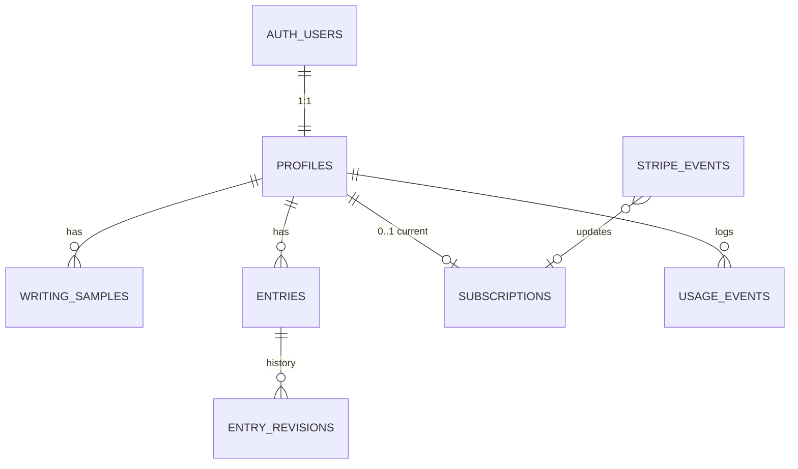

# D6. Data model

**Status:** Draft for PO review · **Owner:** Backend Lead · **Reviewer audit:** required (schema and RLS are never delegated to a Haiku coder)
SQL below is a design sketch, not a migration. The real schema lands only via `supabase/migrations/` plus regenerated types, after Phase 3 is authorized.

## 1. Plain-language overview
A user has one **profile**, a few **writing samples**, and many **entries**. Each entry holds the spoken **transcript** and the AI **rewrite**; every change to either is kept as a **revision**. Stripe's subscription state is mirrored into **subscriptions**; Stripe's messages are logged in **stripe_events** so none is processed twice; **usage_events** records costs (never words). Supabase Auth owns the login record (`auth.users`); everything else points at it.



## 2. Key design decisions
1. **Encrypted content columns.** Transcript, rewrite, revision text and sample text are stored as `bytea` ciphertext (AES-256-GCM, per-user key; see D8 section 3). Dates, status and counts stay readable so the book can be organised and queried. If the PO declines application-level encryption, those columns become `text` and nothing else changes.
2. **Everything has `user_id`.** Every user-data table carries the owner's ID, so every RLS policy is the same one-line check.
3. **Server-side access.** Content is decrypted on the server, so the browser does not read tables directly. RLS stays on as the backstop (the server uses the user's own token for reads/writes).
4. **IDs** are UUIDs (v4 default `gen_random_uuid()`), safe to expose in URLs. Times are `timestamptz` (UTC). Calendar days are `date`.
5. **Plain `text` + `check` constraints** instead of Postgres enum types, so adding a status later is a simple migration.

## 3. Which day does an entry belong to?
Problem: someone recording at 00:40 after a late evening means "today" but the calendar says tomorrow. Also people travel and change time zones.

**Rule (default):**
- The client captures the device's IANA time zone (e.g. `Europe/London`) when recording **starts**.
- Local time before the user's **rollover hour** (default **04:00**, stored in `profiles.day_rollover_hour`, 0-6, editable) counts as the **previous** calendar day. So 00:40 on Tuesday is a Monday entry; 04:01 is Tuesday.
- `entries.entry_date` stores the result. `entries.recorded_at` (UTC instant) and `entries.timezone` are stored too, so the rule can be re-derived or audited.
- The user can **change the date** on any entry (stored as `entry_date`; `date_overridden = true`). Moving to a day that already has entries is allowed (it joins that page).
- The server **validates** the date: it must be within ±2 days of the server's "now" in that time zone when created (stops garbage), but any past date is allowed through the edit-date action. Future dates are rejected.
- Travel: the device zone at recording time wins, not the profile zone. The profile zone is used only for server-side jobs (reminders later).
- Daylight saving: using the local wall-clock hour on the device avoids the 25/23-hour day problem; the stored `date` is never recomputed from UTC arithmetic.
- Tests: 23:59, 00:00, 03:59, 04:00, DST change nights, a time-zone change mid-trip, user with rollover 0 and 6.

## 4. One entry per day or many?
**Recommendation: many entries per day; the book page is the day.**
- Real life: a morning thought, a lunch story, the nightly recording. Forcing one per day means merging or overwriting, which loses content.
- The nightly habit still feels like "one page": the book shows all entries of that `entry_date` on one page, in time order, with a thin divider. Most days will have one.
- A product cap of **10 entries per day** per user (server-enforced) bounds abuse.
- No unique constraint on `(user_id, entry_date)`. Ordering key is `(entry_date, recorded_at)`.
- Streaks and "days journaled" count `distinct entry_date`.

## 5. Tables

### 5.1 `profiles`
```sql
create table public.profiles (
  id                    uuid primary key references auth.users(id) on delete cascade,
  display_name          text check (char_length(display_name) <= 80),
  timezone              text not null default 'UTC',            -- IANA name, validated in app
  day_rollover_hour     smallint not null default 4 check (day_rollover_hour between 0 and 6),
  locale                text not null default 'en',
  reminder_time         time,                                    -- deferred feature: stored only
  -- consent and compliance record
  terms_version         text,           terms_accepted_at   timestamptz,
  privacy_version       text,           privacy_accepted_at timestamptz,
  age_confirmed_at      timestamptz,
  marketing_opt_in      boolean not null default false,
  -- encryption (D8): per-user data key, wrapped (encrypted) by the server master key
  dek_wrapped           bytea not null,
  kek_version           smallint not null default 1,
  -- trial / entitlement helpers
  trial_ends_at         timestamptz,                             -- see subscriptions; used if trial is card-free
  stripe_customer_id    text unique,
  onboarding_completed_at timestamptz,
  deletion_requested_at timestamptz,                             -- grace period for account deletion (D8)
  created_at            timestamptz not null default now(),
  updated_at            timestamptz not null default now()
);
```
- A database trigger on `auth.users` insert creates the profile (`security definer`, fixed `search_path`), with the DEK generated by the server at onboarding, not in SQL, so profile creation is completed by the first server call (profile row exists without consent until then; the app blocks use until `privacy_accepted_at` is set).
- Users may update only `display_name`, `timezone`, `day_rollover_hour`, `locale`, `reminder_time`, `marketing_opt_in` (column-level grants below). Consent fields, DEK, Stripe ID and trial are server-written.

### 5.2 `writing_samples`
```sql
create table public.writing_samples (
  id          uuid primary key default gen_random_uuid(),
  user_id     uuid not null references public.profiles(id) on delete cascade,
  label       text check (char_length(label) <= 80),             -- e.g. "Old journal", plain, user-chosen
  content_ct  bytea not null,                                    -- ciphertext
  word_count  integer not null check (word_count between 1 and 20000),
  position    integer not null default 0,                        -- display/priority order
  is_active   boolean not null default true,                     -- excluded from prompt when false
  created_at  timestamptz not null default now(),
  updated_at  timestamptz not null default now()
);
create index writing_samples_user_idx on public.writing_samples (user_id, position);
```
Cap: 10 samples and 30,000 words per user (server-enforced; also bounds prompt cost). `label` is user-written so treated as private text; it is never sent to analytics.

### 5.3 `entries`
```sql
create table public.entries (
  id               uuid primary key default gen_random_uuid(),
  user_id          uuid not null references public.profiles(id) on delete cascade,
  client_entry_id  uuid not null,                                -- idempotency key from the device
  entry_date       date not null,                                -- "which day" (section 3)
  date_overridden  boolean not null default false,
  recorded_at      timestamptz not null,                         -- instant recording started
  timezone         text not null,                                -- device IANA zone at that moment
  source           text not null default 'voice' check (source in ('voice','typed')),
  status           text not null default 'transcribed'
                   check (status in ('transcribed','rewriting','ready','rewrite_failed')),
  transcript_ct    bytea,                                        -- current transcript (may include user edits)
  rewrite_ct       bytea,                                        -- current rewrite (null until ready)
  transcript_edited boolean not null default false,
  rewrite_edited   boolean not null default false,
  duration_seconds integer check (duration_seconds >= 0),
  word_count_transcript integer,
  word_count_rewrite     integer,
  stt_provider     text,                                         -- 'deepgram' etc., for quality tracking
  rewrite_model    text,                                         -- exact model string used
  prompt_version   text,                                         -- D7 prompt revision
  style_basis      text check (style_basis in ('samples','minimal_edit')),
  version          integer not null default 1,                   -- optimistic concurrency for edits
  deleted_at       timestamptz,                                  -- soft delete (section 7)
  created_at       timestamptz not null default now(),
  updated_at       timestamptz not null default now(),
  unique (user_id, client_entry_id),
  unique (id, user_id)                                           -- target for composite FK
);
create index entries_book_idx   on public.entries (user_id, entry_date, recorded_at) where deleted_at is null;
create index entries_trash_idx  on public.entries (deleted_at) where deleted_at is not null;
```
- "Keep both": `transcript_ct` is the transcript as currently shown; `rewrite_ct` the page as currently shown. The **original** machine transcript and **original** AI rewrite are always recoverable from `entry_revisions` (revision 1 of each field), so "reset to original" is possible after edits.
- No plaintext title in v1 (a title would be content). The book list shows date + word count. If titles are added later they are encrypted columns.
- Count of entries per user per day: enforced in the insert function, not via constraint.

### 5.4 `entry_revisions` (edit history)
```sql
create table public.entry_revisions (
  id          uuid primary key default gen_random_uuid(),
  entry_id    uuid not null,
  user_id     uuid not null,
  field       text not null check (field in ('transcript','rewrite')),
  rev_no      integer not null,                                  -- 1 = original, increasing
  origin      text not null check (origin in ('stt','ai','user_edit','ai_regenerate','restore')),
  content_ct  bytea not null,
  created_at  timestamptz not null default now(),
  foreign key (entry_id, user_id) references public.entries (id, user_id) on delete cascade,
  unique (entry_id, field, rev_no)
);
create index entry_revisions_entry_idx on public.entry_revisions (entry_id, field, rev_no desc);
```
- Revision 1 is written when the transcript/rewrite is first saved; each user edit adds a row. The composite foreign key makes it impossible for a revision to belong to a different user than its entry.
- To limit growth, autosaves while editing collapse into one revision per 10 minutes; keep the original plus the last 30 edits, older middle revisions are pruned by the server. About 5 KB each, so even a heavy editor stays tiny.
- UI scope for v1: view history and restore a previous version. The data is kept regardless.

### 5.5 `subscriptions` (mirror of Stripe)
```sql
create table public.subscriptions (
  user_id                uuid primary key references public.profiles(id) on delete cascade,
  stripe_customer_id     text not null,
  stripe_subscription_id text unique,
  status                 text not null check (status in
                          ('trialing','active','past_due','canceled','unpaid','incomplete','incomplete_expired','paused')),
  price_id               text,
  billing_interval       text check (billing_interval in ('month','year')),
  trial_end              timestamptz,
  current_period_end     timestamptz,
  cancel_at_period_end   boolean not null default false,
  canceled_at            timestamptz,
  latest_stripe_event_at timestamptz not null default 'epoch',   -- ignore out-of-order older events
  updated_at             timestamptz not null default now()
);
```
- One row per user (the current subscription). Past history lives in Stripe.
- **Entitlement function** (server, tested): may record if `status in ('trialing','active')`, or `past_due` within a 3-day grace after `current_period_end` (**decision for PO**: grace length), or `canceled` while `now() < current_period_end`. Reading and exporting are allowed always, including after trial end.
- Written only by the webhook handler (service role). Users have read-only access to their own row. Stripe status names must be checked against the pinned API version **[VERIFY]**.
- Trial design alternatives (PO question): card-required Stripe trial (row created at Checkout) vs card-free app trial (uses `profiles.trial_ends_at`, row created at subscribe). The schema supports both.

### 5.6 `stripe_events` (webhook idempotency)
```sql
create table public.stripe_events (
  id             text primary key,            -- Stripe event ID 'evt_...'
  type           text not null,
  stripe_created timestamptz not null,
  received_at    timestamptz not null default now(),
  processed_at   timestamptz,
  status         text not null default 'received' check (status in ('received','processed','failed','ignored')),
  attempts       integer not null default 0,
  error          text                          -- short code/message, no payload
);
```
- Handler: verify signature on the raw body, `insert ... on conflict (id) do nothing`; if the row already exists and is `processed`, return 200 and do nothing; otherwise process, then mark `processed`. Out-of-order events are handled with `latest_stripe_event_at`. Full payloads are not stored (they contain billing emails); the handler re-fetches the subscription from Stripe by ID as the source of truth.
- Rows are purged after 90 days. No user-facing access.

### 5.7 `usage_events` (cost and abuse log, no content)
```sql
create table public.usage_events (
  id               bigint generated always as identity primary key,
  user_id          uuid references public.profiles(id) on delete cascade,
  entry_id         uuid,                                        -- no FK: survives entry hard-delete
  kind             text not null check (kind in
                    ('rewrite','regenerate','stt_token','stt_batch','export','login_code')),
  provider         text,                                        -- 'anthropic','deepgram',...
  model            text,
  input_tokens     integer, output_tokens integer, cached_input_tokens integer,
  audio_seconds    integer,
  cost_micro_usd   bigint,                                      -- estimate in millionths of a dollar
  latency_ms       integer,
  outcome          text not null check (outcome in ('ok','error','timeout','rate_limited')),
  provider_request_id text,
  created_at       timestamptz not null default now()
);
create index usage_user_day_idx on public.usage_events (user_id, created_at desc);
```
- Doubles as the rate-limit counter (e.g. rewrites in the last 24 hours).
- **Never** stores prompts, outputs, transcripts or free text. An allow-listed insert function (typed columns only) enforces this by construction.
- On account deletion, rows are deleted (cascade). A privacy-safe monthly aggregate (counts and costs, no user ID) is kept for D9 reporting.
- Retention: 13 months, then aggregated and purged.

## 6. Indexes (summary)
| Table | Index | Serves |
|---|---|---|
| entries | `(user_id, entry_date, recorded_at)` partial `deleted_at is null` | book by month/day, "jump to date", streak counts |
| entries | `unique (user_id, client_entry_id)` | idempotent saves |
| entry_revisions | `(entry_id, field, rev_no desc)` | history view |
| writing_samples | `(user_id, position)` | building prompt |
| usage_events | `(user_id, created_at desc)` | rate limits, cost per user |
| entries | `(deleted_at)` partial | trash purge job |
Foreign-key columns used in RLS (`user_id`) are all the leading column of an index, so policy checks are index lookups.

## 7. Soft vs hard delete
- **Entries: soft delete** (`deleted_at`), kept **30 days** in a Trash view the user can restore from, then hard-purged nightly by `pg_cron` (revisions cascade). Reason: accidental deletion of a diary page is painful and irreversible otherwise.
- "Delete forever now" in Trash performs an immediate hard delete.
- **Writing samples:** hard delete immediately (they are replaceable and the user expects them to vanish).
- **Revisions:** only die with the entry or via pruning.
- **Account deletion:** hard delete of everything after a 7-day undo window (D8 section 8).
- Privacy policy states the 30-day trash window plainly.

## 8. RLS policies (sketch)
Enable and force on every table; no policy means no access.

```sql
-- Pattern, shown for entries; the same shape for writing_samples and entry_revisions.
alter table public.entries enable row level security;
alter table public.entries force row level security;

create policy entries_select_own on public.entries
  for select to authenticated using (user_id = (select auth.uid()));
create policy entries_insert_own on public.entries
  for insert to authenticated with check (user_id = (select auth.uid()));
create policy entries_update_own on public.entries
  for update to authenticated
  using (user_id = (select auth.uid()))
  with check (user_id = (select auth.uid()));
-- no DELETE policy for authenticated: deletes are soft (update) or run by the purge job.

-- user_id can never be changed after insert:
create function public.forbid_user_id_change() returns trigger
language plpgsql set search_path = '' as $$
begin
  if new.user_id <> old.user_id then raise exception 'user_id is immutable'; end if;
  return new;
end $$;
create trigger entries_user_id_immutable before update on public.entries
  for each row execute function public.forbid_user_id_change();

-- profiles: owner may read; may update only listed columns
alter table public.profiles enable row level security;
alter table public.profiles force row level security;
create policy profiles_select_own on public.profiles for select to authenticated
  using (id = (select auth.uid()));
create policy profiles_update_own on public.profiles for update to authenticated
  using (id = (select auth.uid())) with check (id = (select auth.uid()));
revoke update on public.profiles from authenticated;
grant update (display_name, timezone, day_rollover_hour, locale, reminder_time, marketing_opt_in)
  on public.profiles to authenticated;

-- subscriptions: read-only for the owner; writes via service role only
alter table public.subscriptions enable row level security;
alter table public.subscriptions force row level security;
create policy subs_select_own on public.subscriptions for select to authenticated
  using (user_id = (select auth.uid()));

-- stripe_events: RLS on, NO policies => invisible to clients
alter table public.stripe_events enable row level security;
alter table public.stripe_events force row level security;

-- usage_events: owner may read their own usage; inserts by server only
alter table public.usage_events enable row level security;
alter table public.usage_events force row level security;
create policy usage_select_own on public.usage_events for select to authenticated
  using (user_id = (select auth.uid()));
```
Other rules:
- `anon` role gets no grants on any table (`revoke all ... from anon`).
- Any `security definer` function sets `search_path = ''` and is covered by a test (a classic RLS bypass if forgotten).
- Views over user data use `security_invoker = true` so they respect RLS.
- Because the Supabase API exposes the `public` schema, ciphertext columns would be readable to the owner only; the server still decrypts. Even a policy bug that exposed another user's row would expose ciphertext, not words (defence in depth).
- Do not rely on `user_metadata` in the JWT for authorization (users can edit it); use `auth.uid()` only.

## 9. Cross-user isolation test plan
Automated, runs in CI against a local Supabase (pgTAP for SQL-level, Vitest for API-level). The suite **fails the build** on any leak.

1. **Fixtures:** users A and B each with a profile, 2 samples, 3 entries (one soft-deleted), revisions, a subscription, usage rows. Plus an anonymous client.
2. **Matrix:** for every table in `public` and each of select / insert / update / delete, as: A on own rows (expected allowed or denied per policy), A on B's rows (must see 0 rows / affect 0 rows / error), anon (must be denied), and service role (allowed, only in explicitly listed code paths).
3. **Spoofing attempts:** A inserts a row with `user_id = B`; A updates own row to `user_id = B`; A inserts a revision pointing to B's `entry_id`; A inserts a revision with own `user_id` but B's entry (composite FK must reject).
4. **Column-level:** A tries to update own `dek_wrapped`, `stripe_customer_id`, `terms_accepted_at`, `trial_ends_at`, and a subscription row (all must fail).
5. **Structural checks (cheap and catch new tables):** a test queries `pg_class` / `pg_policies` and fails if any table in `public` has `relrowsecurity = false` or `relforcerowsecurity = false`, or if any table is granted to `anon`; fails if a `security definer` function lacks `search_path`; fails on views without `security_invoker`.
6. **API layer:** with A's session, call every `/api/v1` route with B's entry/sample IDs (read, edit, delete, rewrite, export). Expected 404 (not 403, so existence is not revealed) and no usage cost recorded.
7. **Storage:** (when photos arrive) the same matrix on bucket policies.
8. **Webhooks:** replay the same Stripe event twice (one state change); out-of-order older event ignored; bad signature rejected.
9. **Deletion:** after deleting A, queries for A's ID across all tables return 0 rows, B's data is untouched.
10. **Reviewer gate:** the Reviewer agent re-runs this suite on every PR that touches `supabase/migrations/`.

## 10. Extension points for deferred features
Nothing below is built in v1; the schema just does not block it.

| Feature | How it fits |
|---|---|
| **On this day** | Query `entry_date` for the same month/day in earlier years; the `(user_id, entry_date)` index serves it (one range lookup per year). No new table. |
| **Weekly/monthly recaps and insights** | New table `recaps (id, user_id, period_start, period_end, kind, content_ct, model, created_at)`; generated from entries server-side; same RLS pattern. Opt-in, since it processes more content through AI. |
| **Reminders and streaks** | `profiles.reminder_time` + `profiles.timezone` already stored. Add `push_subscriptions (id, user_id, endpoint, keys_ct, created_at)` and a reminders job. Streaks are **derived** from `distinct entry_date` (no stored counter to drift). |
| **Photos on pages** | New `entry_media (id, entry_id, user_id, storage_path, mime, bytes, caption_ct, position)` plus a private Storage bucket with folder-per-user policies; composite FK like revisions. Size/quota rules decided then. |
| **Printed book** | `book_orders (id, user_id, date_range, status, vendor_order_id, shipping_ct, ...)`; address data is highly personal, encrypted and deleted after fulfilment. Needs a print vendor (new sub-processor, D8 update). |
| **Search** | Not possible over ciphertext without a plan. If wanted, options are client-side search over decrypted pages, or a separate encrypted blind index; decide with the PO before building. Mentioned so no one is surprised. |
| **Native apps** | Same tables and API. `entries.source` and `stt_provider` already allow other capture methods. |

Migration discipline: each new feature is an additive migration (new table or nullable column), never a change that rewrites encrypted columns.

## 11. Seed data and types
- `supabase/seed.sql` creates two demo users and sample entries (clearly fake text, with ciphertext produced by a test key) for local dev and isolation tests.
- Types come from `supabase gen types typescript`, regenerated and committed with every migration; CI fails if the committed types differ from a fresh generation.
- Zod schemas for rows live in the shared package and are checked against the generated types by a type-level test.

## 12. Open questions for the PO
See the Backend Lead report: entry-per-day, 4 a.m. rollover default, 30-day trash, grace period after payment failure, trial style.
